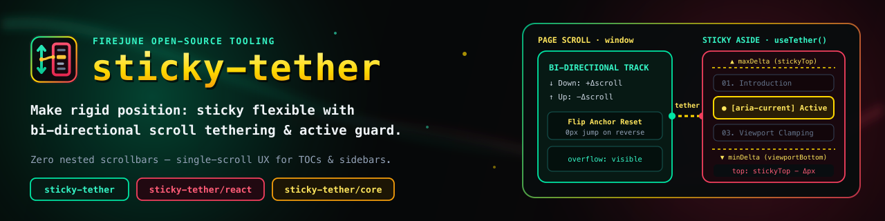

[](https://www.npmjs.com/package/sticky-tether)
[](https://www.npmjs.com/package/sticky-tether)
[](LICENSE)

# sticky-tether

**Make rigid `position: sticky` flexible.** Bi-directional scroll tethering with an active-item viewport guard — eliminating nested scrollbars on long sidebars, floating menus, and Table of Contents (`On This Page`) panels.

---

## Why `sticky-tether`?

When a sticky sidebar, accordion menu, or Table of Contents (TOC) grows **taller than the viewport**, native CSS `position: sticky` pins only its top edge — permanently cutting off everything below the screen until the user reaches the bottom of the page.

Existing workarounds force an unpleasant tradeoff:

| Approach | How it works | What goes wrong |
| :--- | :--- | :--- |
| **Nested Scrollbar (`overflow-y: auto`)** | Locks sidebar height to `calc(100vh - ...)` with an internal scrollbar + `scrollIntoView` | Creates an ugly **double scrollbar**; users must move the cursor over the sidebar to scroll it; jumps abruptly on section changes |
| **Generic Sticky Box (`react-sticky-box`)** | Toggles between `position: relative` and `sticky` with spacer offsets | **No awareness of the active/focused item** — scrolling down a long first section pushes the active item off the top of the screen; scrolling up a long last section pushes the active item off the bottom |
| **`sticky-tether` ✨** | Pure `position: sticky` + bi-directional scroll delta tethering + **Active Item Viewport Guard** | **Zero nested scrollbars**; responds 1:1 to single-page scroll in both directions; **guarantees the focused TOC/menu item never escapes the visible viewport** |

---

## Key Features

1. **Bi-Directional Scroll Tethering**
   - Tracks `window` (or any custom scroll container) in both `down` and `up` directions.
   - Re-anchors immediately when reversing scroll direction so the sidebar glides in the new direction without waiting or jumping.
2. **Active Item Viewport Guard (`[minDeltaLimit, maxDeltaLimit]`)**
   - Automatically detects the active item inside the sticky element (`[aria-current="location"]`, `[aria-current="page"]`, `[data-active="true"]`, `.active`, or a custom selector).
   - **Scrolling Down**: Prevents the active item from being pushed above the top sticky boundary (`stickyTop`).
   - **Scrolling Up**: Prevents the active item from being pushed below the bottom viewport boundary (`window.innerHeight - bottomPadding`).
   - **Zero Scroll Debt**: Synchronizes the scroll anchor whenever clamped at a boundary so advancing to the next section glides smoothly from the exact current position.
3. **Pure `position: sticky` & Zero Dependencies**
   - Never toggles `position: relative` or injects layout spacer nodes — immune to sibling layout shifts (lazy images, videos, embeds).
   - Built-in `ResizeObserver` and `MutationObserver` automatically recalculate bounds when accordion menus expand/collapse or active states change.

---

## Installation

```bash
npm install sticky-tether
# or
yarn add sticky-tether
# or
pnpm add sticky-tether
```

---

## Quick Start

### 1. React Hook (`useTether` / `useStickyTether`)

Remove `max-height` and `overflow-y: auto` from your sidebar/TOC CSS so its natural height is used, and attach `useTether`:

```tsx
import { useTether } from 'sticky-tether'

export function PageAside({ toc, activeId }: { toc: TocItem[]; activeId: string }) {
  const asideRef = useTether<HTMLElement>({
    headerHeight: '--notion-header-height', // or a number in px, e.g. 54
    topPadding: 30,
    bottomPadding: 24
  })

  return (
    <aside ref={asideRef} style={{ position: 'sticky', top: 84 }}>
      <nav aria-label="On this page">
        {toc.map((item) => (
          <a
            key={item.id}
            href={`#${item.id}`}
            aria-current={activeId === item.id ? 'location' : undefined}
          >
            {item.title}
          </a>
        ))}
      </nav>
    </aside>
  )
}
```

### 2. React Component (`<StickyTether>`)

```tsx
import { StickyTether } from 'sticky-tether'

export function SidebarMenu() {
  return (
    <StickyTether as="aside" headerHeight={60} topPadding={24} bottomPadding={24}>
      <ul className="sidebar-menu">
        <li><a href="/overview" aria-current="page">Overview</a></li>
        {/* ...long accordion menu items... */}
      </ul>
    </StickyTether>
  )
}
```

### 3. Vanilla JS / Framework-Agnostic Core (`sticky-tether/core`)

Use `createStickyTether` directly in Vue, Svelte, Astro, or plain HTML/JS:

```ts
import { createStickyTether } from 'sticky-tether/core'

const aside = document.querySelector<HTMLElement>('.sidebar-aside')!
const tether = createStickyTether(aside, {
  headerHeight: 54,
  topPadding: 30,
  bottomPadding: 24
})

// Later, on cleanup:
// tether.destroy()
```

---

## Options (`StickyTetherOptions`)

| Option | Type | Default | Description |
| :--- | :--- | :--- | :--- |
| `headerHeight` | `number \| string` | `'--header-height'` | Fixed header height in `px`, or a CSS custom property name (auto-checks `--header-height` and `--notion-header-height`). |
| `defaultHeaderHeight` | `number` | `0` | Fallback header height in `px` when no CSS custom property is found. |
| `topPadding` | `number` | `0` | Extra spacing (in `px`) below the fixed header when stuck at the top. |
| `bottomPadding` | `number` | `24` | Extra spacing (in `px`) above the bottom of the viewport when stuck at the bottom. |
| `offsetTop` | `number` | `0` | Initial offset (in `px`) before sticky tethering engages. |
| `container` | `HTMLElement \| Window \| string \| null` | `window` | Scroll container element, `window`, or a CSS selector string (e.g. `'#app-container'`). |
| `activeSelector` | `string \| false` | `'[aria-current="location"], [aria-current="page"], [data-active="true"], .active'` | CSS selector for the active/focused item inside the sticky element to guard within the viewport. Set to `false` to disable active-item clamping. |

---

## License

[MIT](LICENSE) © [firejune](https://github.com/firejune)
