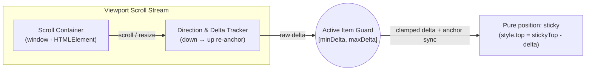

<p align="center">
  
</p>

<p align="center">
  <a href="https://www.npmjs.com/package/sticky-tether"></a>
  
  
  <a href="LICENSE"></a>
</p>

<p align="center">
  <strong>English</strong> · <a href="docs/ko/README.md">한국어</a>
</p>

A zero-dependency bi-directional scroll tethering library for **long sticky sidebars, floating accordion menus, and Table of Contents (`On This Page`) panels** that exceed the viewport height. Built for both **Vanilla JS (`sticky-tether/core`)** and **React (`sticky-tether`)**.

Instead of trapping sidebars inside nested `overflow-y: auto` scrollbars or toggling `position: relative` spacer nodes that break on layout shifts, **Sticky Tether** keeps pure `position: sticky` and dynamically modulates `top` in response to up/down scroll deltas — while clamping bounds so the currently active item never escapes the visible viewport.

## Documentation Map

| Audience | English | 한국어 |
| --- | --- | --- |
| Overview & Quickstart | [README.md](README.md) | [docs/ko/README.md](docs/ko/README.md) |
| Contributing Guide | [CONTRIBUTING.md](CONTRIBUTING.md) | — |
| Release & OIDC Pipeline | [RELEASING.md](RELEASING.md) | — |

## Architecture & Scroll Mechanics



| Approach | Mechanism | Behavior on Tall Sidebars / TOCs |
| --- | --- | --- |
| **Native `position: sticky`** | Pins top edge at `top: Npx` | Everything below `100vh` is permanently clipped until the bottom of the page |
| **Nested Scrollbar (`overflow-y: auto`)** | Internal scroll container + `scrollIntoView` | Creates an ugly **double scrollbar**; requires hovering the sidebar to scroll; jumps on section change |
| **Generic Sticky Box (`react-sticky-box`)** | Switches between `position: relative` and `sticky` | **Unaware of the active TOC/menu item** — scrolling down a long top section pushes the active item off the top of the screen; scrolling up a long bottom section pushes it off the bottom |
| **Sticky Tether (`sticky-tether`)** | Pure `position: sticky` + bi-directional delta tethering + **Active Item Viewport Guard** | **Zero nested scrollbars**; glides 1:1 with page scroll in both directions; **guarantees the focused item (`[aria-current]`) stays inside the visible viewport** |

## Installation

```bash
npm install sticky-tether
# or
pnpm add sticky-tether
# or
yarn add sticky-tether
```

## Quickstart

### 1. React Hook (`useTether` / `useStickyTether`)

Remove `max-height` and `overflow-y: auto` from your sidebar/TOC CSS so its natural height is used, and attach `useTether`:

```tsx
import { useTether } from 'sticky-tether'

export function PageAside({ toc, activeId }: { toc: TocItem[]; activeId: string }) {
  const asideRef = useTether<HTMLElement>({
    headerHeight: '--notion-header-height', // or a number in px, e.g. 54
    topPadding: 30,
    bottomPadding: 24
  })

  return (
    <aside ref={asideRef} style={{ position: 'sticky', top: 84 }}>
      <nav aria-label="On this page">
        {toc.map((item) => (
          <a
            key={item.id}
            href={`#${item.id}`}
            aria-current={activeId === item.id ? 'location' : undefined}
          >
            {item.title}
          </a>
        ))}
      </nav>
    </aside>
  )
}
```

### 2. React Component (`<StickyTether>`)

```tsx
import { StickyTether } from 'sticky-tether'

export function SidebarMenu() {
  return (
    <StickyTether as="aside" headerHeight={60} topPadding={24} bottomPadding={24}>
      <ul className="sidebar-menu">
        <li><a href="/overview" aria-current="page">Overview</a></li>
        {/* ...long accordion menu items... */}
      </ul>
    </StickyTether>
  )
}
```

### 3. Vanilla JS / Framework-Agnostic Core (`sticky-tether/core`)

Use `createStickyTether` directly in Vue, Svelte, Astro, or plain HTML/JS:

```ts
import { createStickyTether } from 'sticky-tether/core'

const aside = document.querySelector<HTMLElement>('.sidebar-aside')!
const tether = createStickyTether(aside, {
  headerHeight: 54,
  topPadding: 30,
  bottomPadding: 24
})

// Later, on cleanup:
// tether.destroy()
```

## Core Capabilities

### 1. Bi-Directional Scroll Tethering

Tracks `window` (or any custom scroll container) in both `down` and `up` directions. The moment the user reverses scroll direction, `Sticky Tether` re-anchors `stickyScrollTop` to the current scroll position so the sidebar glides in the new direction immediately without waiting to unwind prior scroll distance.

### 2. Active Item Viewport Guard (`[minDeltaLimit, maxDeltaLimit]`)

Automatically detects the focused element inside the sticky container (`[aria-current="location"]`, `[aria-current="page"]`, `[data-active="true"]`, `.active`, or a custom `activeSelector`):

- **Scrolling Down (`maxDeltaLimit`)**: Prevents the active item's top edge from being pushed above the top sticky boundary (`stickyTop`).
- **Scrolling Up (`minDeltaLimit`)**: Prevents the active item's bottom edge from being pushed below the bottom viewport boundary (`viewportHeight - bottomPadding`).
- **Zero Scroll Debt**: Synchronizes the internal scroll anchor whenever clamped at a boundary so advancing to the next section glides smoothly from the exact current offset.

### 3. Options (`StickyTetherOptions`)

| Option | Type | Default | Description |
| --- | --- | --- | --- |
| `headerHeight` | `number \| string` | `'--header-height'` | Fixed header height in `px`, or a CSS custom property name (auto-checks `--header-height` and `--notion-header-height`). |
| `defaultHeaderHeight` | `number` | `0` | Fallback header height in `px` when no CSS custom property is found. |
| `topPadding` | `number` | `0` | Extra spacing (in `px`) below the fixed header when stuck at the top. |
| `bottomPadding` | `number` | `24` | Extra spacing (in `px`) above the bottom of the viewport when stuck at the bottom. |
| `offsetTop` | `number` | `0` | Initial offset (in `px`) before sticky tethering engages. |
| `container` | `HTMLElement \| Window \| string \| null` | `window` | Scroll container element, `window`, or a CSS selector string (e.g. `'#app-container'`). |
| `activeSelector` | `string \| false` | `'[aria-current="location"], [aria-current="page"], [data-active="true"], .active'` | CSS selector for the active/focused item inside the sticky element to guard within the viewport. Set to `false` to disable active-item clamping. |

## Development & Verification

Run the full typecheck, unit test suite, and package build before committing any changes:

```bash
npm test
npm run build
```

## License

[MIT](LICENSE)
