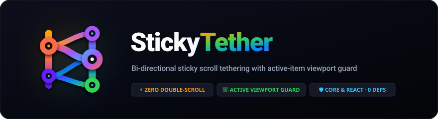
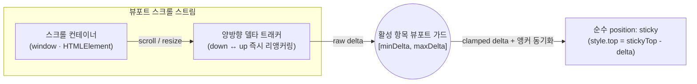

<p align="center">
  
</p>

<p align="center">
  <a href="https://www.npmjs.com/package/sticky-tether"></a>
  <a href="https://www.npmjs.com/package/sticky-tether"></a>
  <a href="../../LICENSE"></a>
</p>

<p align="center">
  <a href="../../README.md">English</a> · <strong>한국어</strong>
</p>

뷰포트(`100vh`)보다 긴 **스티키 사이드바, 플로팅 아코디언 메뉴, 목차(`On This Page` TOC) 패널**에서 내부 이중 스크롤바(`overflow-y: auto`)를 제거하고 브라우저 단일 스크롤과 부드럽게 연동하는 제로 디펜던시 라이브러리다. **Vanilla JS (`sticky-tether/core`)** 와 **React (`sticky-tether`)** 를 모두 지원한다.

사이드바에 이중 스크롤바를 가두거나 `position: relative` 스페이서를 주입해 레이아웃 시프트를 유발하는 기존 방식 대신, 순수 `position: sticky` 상태에서 상·하 양방향 스크롤 델타에 맞춰 `top` 오프셋을 실시간 보간하며 **현재 활성화된(포커스된) 항목이 뷰포트 밖으로 밀려나지 않도록 클램핑 가드**를 제공한다.

## 문서 구성

| 대상 | English | 한국어 |
| --- | --- | --- |
| 개요 및 빠른 시작 | [README.md](../../README.md) | [docs/ko/README.md](README.md) |
| 기여 가이드 | [CONTRIBUTING.md](../../CONTRIBUTING.md) | — |
| 릴리스 및 OIDC 배포 | [RELEASING.md](../../RELEASING.md) | — |

## 아키텍처 및 스크롤 메커니즘



| 방식 | 동작 원리 | 긴 사이드바 / TOC에서의 한계 및 특징 |
| --- | --- | --- |
| **기본 `position: sticky`** | 상단 `top: Npx` 고정 | 화면(`100vh`) 아래로 넘어간 하위 메뉴·목차는 페이지 맨 끝에 도달할 때까지 영구적으로 잘림 |
| **내부 스크롤바 (`overflow-y: auto`)** | 내부 스크롤 컨테이너 + `scrollIntoView` | 지저분한 **이중 스크롤바(Double Scrollbar)** 발생, 마우스 커서를 옮겨야만 탐색 가능, 섹션 전환 시 덜컥거리는 점프 발생 |
| **일반 스티키 박스 (`react-sticky-box`)** | `position: relative` ↔ `sticky` 전환 | **현재 포커스된 활성 항목을 전혀 인지하지 못함** — 긴 상단 섹션을 내릴 때 활성 목차가 화면 위로 밀려 사라지거나, 긴 하단 섹션에서 올릴 때 화면 아래로 밀려 사라짐 |
| **Sticky Tether (`sticky-tether`)** | 순수 `position: sticky` + 양방향 델타 테더링 + **활성 항목 뷰포트 가드** | **내부 스크롤바 제로(0)**, 상·하 단일 스크롤에 1:1 즉각 반응, **활성 항목(`[aria-current]`)이 언제나 화면 안에 머물도록 보장** |

## 설치 (Installation)

```bash
npm install sticky-tether
# 또는
pnpm add sticky-tether
# 또는
yarn add sticky-tether
```

## 빠른 시작 (Quickstart)

### 1. React Hook (`useTether` / `useStickyTether`)

사이드바/TOC CSS에서 `max-height`와 `overflow-y: auto`를 제거해 자연스러운 전체 높이를 갖게 한 뒤 `useTether`를 연결한다:

```tsx
import { useTether } from 'sticky-tether'

export function PageAside({ toc, activeId }: { toc: TocItem[]; activeId: string }) {
  const asideRef = useTether<HTMLElement>({
    headerHeight: '--notion-header-height', // 또는 픽셀 숫자 (예: 54)
    topPadding: 30,
    bottomPadding: 24
  })

  return (
    <aside ref={asideRef} style={{ position: 'sticky', top: 84 }}>
      <nav aria-label="On this page">
        {toc.map((item) => (
          <a
            key={item.id}
            href={`#${item.id}`}
            aria-current={activeId === item.id ? 'location' : undefined}
          >
            {item.title}
          </a>
        ))}
      </nav>
    </aside>
  )
}
```

### 2. React Component (`<StickyTether>`)

```tsx
import { StickyTether } from 'sticky-tether'

export function SidebarMenu() {
  return (
    <StickyTether as="aside" headerHeight={60} topPadding={24} bottomPadding={24}>
      <ul className="sidebar-menu">
        <li><a href="/overview" aria-current="page">Overview</a></li>
        {/* ...긴 아코디언 메뉴 항목들... */}
      </ul>
    </StickyTether>
  )
}
```

### 3. Vanilla JS / 프레임워크 독립 코어 (`sticky-tether/core`)

Vue, Svelte, Astro 또는 순수 HTML/JS 환경에서 `createStickyTether`를 직접 사용할 수 있다:

```ts
import { createStickyTether } from 'sticky-tether/core'

const aside = document.querySelector<HTMLElement>('.sidebar-aside')!
const tether = createStickyTether(aside, {
  headerHeight: 54,
  topPadding: 30,
  bottomPadding: 24
})

// 정리(cleanup) 시:
// tether.destroy()
```

## 핵심 기능 (Core Capabilities)

### 1. 양방향 스크롤 테더링 (Bi-Directional Scroll Tethering)

`window` 또는 지정한 스크롤 컨테이너의 `down` / `up` 양방향 스크롤을 추적한다. 사용자가 스크롤 방향을 바꾸는 즉시 `stickyScrollTop` 기준점을 현재 위치로 리앵커링하여, 이전 스크롤 거리를 되감기 위해 기다리지 않고 새 방향으로 즉시 미끄러지듯 반응한다.

### 2. 활성 항목 뷰포트 가드 (`[minDeltaLimit, maxDeltaLimit]`)

스티키 컨테이너 내부의 포커스 항목(`[aria-current="location"]`, `[aria-current="page"]`, `[data-active="true"]`, `.active`, 또는 커스텀 `activeSelector`)을 자동 감지한다:

- **아래로 스크롤 시 (`maxDeltaLimit`)**: 활성 항목의 상단이 상단 스티키 경계(`stickyTop`) 위로 밀려 올라가지 않도록 리밋을 건다.
- **위로 스크롤 시 (`minDeltaLimit`)**: 활성 항목의 하단이 뷰포트 하단 경계(`viewportHeight - bottomPadding`) 아래로 밀려 내려가지 않도록 리밋을 건다.
- **스크롤 부채 제로 (Zero Scroll Debt)**: 클램프 경계에 도달해 멈춰 있는 동안 내부 스크롤 앵커를 함께 동기화하여, 다음 섹션으로 포커스가 넘어가는 순간 지연 없이 현재 위치에서 부드럽게 이어진다.

### 3. 옵션 (`StickyTetherOptions`)

| 옵션 | 타입 | 기본값 | 설명 |
| --- | --- | --- | --- |
| `headerHeight` | `number \| string` | `'--header-height'` | 고정 헤더 높이(`px`) 또는 CSS 변수명 (`--header-height`, `--notion-header-height` 자동 탐색). |
| `defaultHeaderHeight` | `number` | `0` | CSS 변수가 없을 때 사용할 기본 헤더 높이(`px`). |
| `topPadding` | `number` | `0` | 상단 고정 시 헤더 아래에 추가할 여백(`px`). |
| `bottomPadding` | `number` | `24` | 하단 고정 시 뷰포트 바닥 위에 추가할 여백(`px`). |
| `offsetTop` | `number` | `0` | 스티키 테더링이 시작되기 전의 초기 오프셋(`px`). |
| `container` | `HTMLElement \| Window \| string \| null` | `window` | 스크롤 컨테이너 엘리먼트, `window`, 또는 CSS 셀렉터 문자열(예: `'#app-container'`). |
| `activeSelector` | `string \| false` | `'[aria-current="location"], [aria-current="page"], [data-active="true"], .active'` | 뷰포트 내부에 가둘 활성 항목 CSS 셀렉터. `false`로 설정 시 비활성화. |

## 개발 및 검증 (Development & Verification)

변경 사항 커밋 전 타입체크, 단위 테스트, 빌드를 실행한다:

```bash
npm test
npm run build
```

## 라이선스 (License)

[MIT](../../LICENSE)
